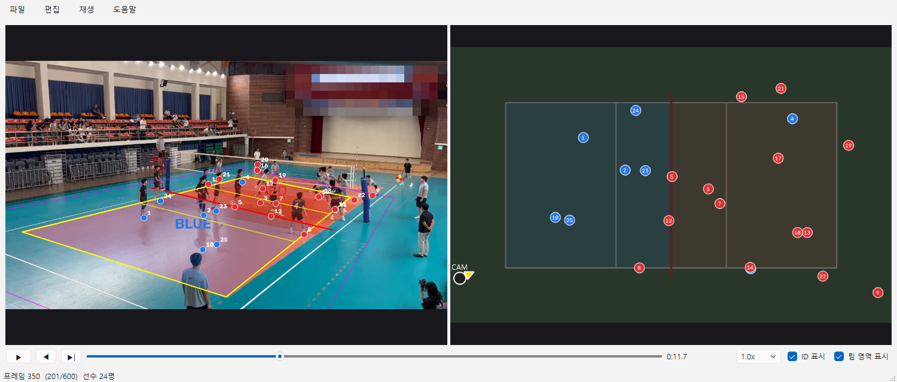

# CourtBird

Turns match video of a net sport (volleyball first) into a **top-down court diagram**: every player is a
coloured circle with an id, the colour says which side of the net they play on, and the video and the
diagram can be inspected, played back and corrected side by side.



*The viewer. Left: the source video with the court and every recorded player projected back onto it. Right: the
top view with team zones (blue / red) and the estimated camera position ("CAM"). The scoreboard area of the
frame is obscured; the video itself is not part of this repository.*

> **Status: early alpha (0.1.0).** Developed and measured on **one** match video from a fixed camera. Several
> parts are validated only on synthetic data (see [Limits](#limits)). The ball is not detected yet. Expect rough
> edges. See [docs/ROADMAP.md](docs/ROADMAP.md) for what is done and what is missing.

## What it does

1. **Detects and tracks people** (RTMDet, Kalman filter + colour appearance + ByteTrack-style matching), keeping
   ids through occlusion by stitching tracklets offline.
2. **Maps them onto the court** with a homography from a few clicked court landmarks, drops non-players
   (spectators, staff) and assigns teams by the side of the net.
3. **Handles a moving camera** (pan / tilt / zoom) by estimating the camera motion from the static background.
4. **Recognises where the video was shot from** (behind an end line, from a sideline, from a corner), both from
   the calibration and, independently, from where people stand.
5. **Saves everything to a record file** (`.cbrec`) that a viewer opens instantly; records can be hand-corrected
   (move / add / delete players, swap teams, rename ids) and saved again.

Renderer and perception only talk through court-space positions (`courtbird.schema.FrameState`, metres, net at
the middle), so another detector can be plugged in without touching the drawing code.

## Install

Developed and tested on Windows 11, Python 3.10, an NVIDIA RTX 3060. Other platforms are untested (the code is
plain Python; adapt the paths and the CUDA step).

```powershell
git clone https://github.com/S1eepup6/CourtBird.git
cd CourtBird
python -m venv .venv
.venv\Scripts\python -m pip install -e ".[gpu,dev]"      # no NVIDIA GPU: use ".[cpu,dev]" instead
.venv\Scripts\python -m pip install --no-deps rtmlib     # --no-deps: rtmlib would pull a CPU onnxruntime
```

GPU only - CUDA 12 libraries for ONNX Runtime (proprietary NVIDIA wheels, see
[THIRD_PARTY_NOTICES.md](THIRD_PARTY_NOTICES.md)). These pins matched the system CUDA 12.8; the newest cuDNN
(9.28) failed with onnxruntime 1.23.2:

```powershell
.venv\Scripts\python -m pip install nvidia-cudnn-cu12==9.10.2.21 nvidia-cublas-cu12==12.8.4.1 nvidia-cuda-runtime-cu12==12.8.90 nvidia-cuda-nvrtc-cu12==12.8.93 nvidia-cufft-cu12==11.3.3.83 nvidia-curand-cu12==10.3.9.90 nvidia-nvjitlink-cu12==12.8.93
```

Download the detector weights (not shipped; hashes recorded in [docs/licenses.md](docs/licenses.md)):

```powershell
.venv\Scripts\python tools\download_models.py
```

Check the install: `.venv\Scripts\python -m pytest` (the tests need no GPU, video or weights).

## Use

```powershell
# 1. calibrate once per camera position: click court landmarks on a frame (r = snap to lines/edges)
.venv\Scripts\python -m tools.calibrate VIDEO.mp4 calib.json --sec 5
# 2. check it
.venv\Scripts\python -m tools.overlay VIDEO.mp4 calib.json check.png --sec 30
# 3. analyse (add --stride 2 for twice the speed, --no-camera for a fixed camera)
.venv\Scripts\python -m tools.analyze VIDEO.mp4 calib.json match.cbrec --start 0 --end 60
# 4. look at / correct the result
.venv\Scripts\python -m courtbird.viewer match.cbrec
```

The viewer (Korean UI) can also run the analysis itself (File > Analyze video). Top-view editing: drag to move,
double-click to add a player, right-click to place the ball, `Delete`, `T` swap a player's team (`Shift+T` for
all following frames), `I` rename id, `Ctrl+T` swap blue/red everywhere, `Ctrl+Z` undo, `Ctrl+S` save,
`Ctrl+I` shooting-viewpoint info. `python -m tools.track_metrics match.cbrec` prints tracking-quality proxies.

## How it works

- **Tracking happens in image space** (distances in "person heights"), so identity does not depend on the court
  calibration and a calibration corrected later does not invalidate tracks. Offline, tracklets are stitched across
  occlusions, projected through the calibration, filtered (outside the court / standing still beside it), gap-filled
  and smoothed; a track's team is the side of the net it spends most of its time on.
  On the 20 s test clip this cut the id count from 193 to 36 and raised the median track length from 1.5 s to 17 s.
  Speed on an RTX 3060 at 1280x720 with decode, inference and tracking in overlapping threads: ~43 fps with
  `rtmdet-m`, ~78 fps with `rtmdet-nano`.
- **Calibration** is a plane homography from clicked landmarks (court corners, net posts, attack lines). A
  refinement step (`courtbird/court/refine.py`) snaps the corners to line / colour-edge evidence, moving each at
  most 35 px. It tidies hand clicks and follows slow drift but is **not precise** (perturbed seeds agree to ~23 px)
  and cannot find the court from scratch: on the test venue the court is a coloured floor area and the strongest
  white lines belong to another sport, so a line-only detector failed.
- **Camera motion** (`courtbird/court/camera_motion.py`): background corner features, spread over a grid, are
  tracked from a *keyframe* with RANSAC homographies (people masked out). Chaining frame-to-frame homographies
  drifted 45 px to 289 px on a static camera, hence keyframes (0.3-1 px from direct SIFT registration after 10 min).
  Detections are mapped back to the calibration view before tracking; the per-frame motion is stored in the record.
- **Viewpoint** (`courtbird/court/viewpoint.py`) reports `beta`, the angle between the viewing direction (on the
  floor) and the court's long axis. From the calibration it is exact on synthetic cameras (3 px corner noise:
  median position error 0.64 m, 95% correct end/corner/side class over 300 random cameras). Without calibration
  it is estimated from people alone (person height vs foot row gives the horizon; the court axis is the direction
  between the two teams' centroids): in simulation median error ~8 degrees and ~86% right end-vs-side, a coarse
  hint only. Plain image layout does not work: end and side views both make players look wide.

## Limits

- One venue, one fixed-camera video. Camera-motion handling was validated on **synthetic** pan/zoom applied to real
  frames (players land 0.17 m median from the fixed-camera result with compensation, 1.19 m without), not on
  genuinely handheld footage. The layout-based viewpoint estimate was validated mainly in simulation.
- No ground truth for ids: tracking quality is measured with proxies (id count, track length), not accuracy.
- The court calibration is manual (clicks + snapping). Results are only as good as the calibration.
- Team = side of the net, so players glued to the net can flip colour; same-kit players are told apart by motion only.
- No ball detection or height estimation yet. Broadcast footage with camera cuts is not handled.
- Only indoor volleyball is defined (`courtbird/sports/`); other net sports mean adding a `SportSpec`.

## Project layout

```
courtbird/
  schema.py, record.py      court-space data contract and the .cbrec file
  sports/                   court definitions (volleyball)
  perception/               RTMDet detector, tracker, offline post-processing
  court/                    calibration, refinement, camera motion, viewpoint, players
  render/                   top-view renderer (knows nothing about video)
  viewer/                   PySide6 viewer / editor
  pipeline.py               video -> record
tools/                      calibration, analysis, metrics and debugging tools
tests/                      unit tests (no GPU / video needed)
docs/                       roadmap, model licence notes
```

## AI assistance

This project - the code, the tests and the documentation, including this README - was written with substantial
help from an AI assistant (**Claude, by Anthropic, used through Claude Code**), working under the direction of the
repository owner, who set the requirements, supplied the test footage and decided what to publish. The numbers
in this README come from experiments run during that development on a single video; treat them as indicative and
verify them on your own footage. Please open an issue if something looks wrong.

## License

Apache License 2.0 - see [LICENSE](LICENSE) and [NOTICE](NOTICE). Third-party software, model weights and
methods are acknowledged in [THIRD_PARTY_NOTICES.md](THIRD_PARTY_NOTICES.md); model-licence details are in
[docs/licenses.md](docs/licenses.md). The match video used during development is not included and is not covered
by this licence.
